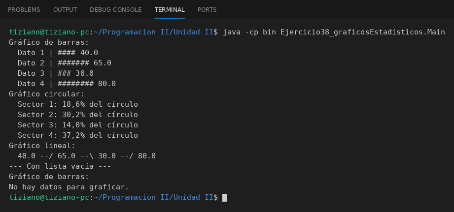

# GeneradorGrafico

Programación II - Unidad 2 - Ejercicio 38

## Consigna
Representar datos estadísticos en distintos gráficos por consola.

## Lógica
- Clase abstracta `GeneradorGrafico` con la lista de datos, el método abstracto `renderizarGrafico()` y una validación de lista vacía.
- `GraficoBarras` (barras con `#`), `GraficoCircular` (porcentajes) y `GraficoLineal` (tendencia entre puntos).
- `Main`: los tres gráficos con los mismos datos y un intento con lista vacía.

## Ejecución

